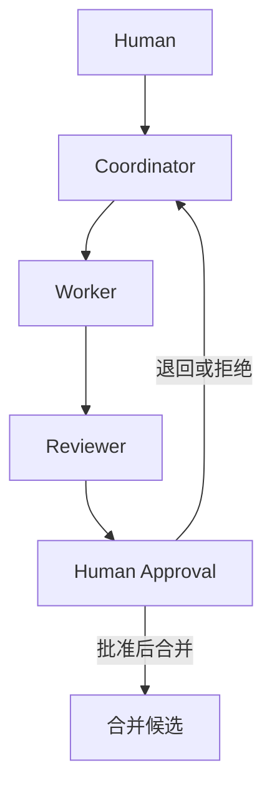

# 架构说明

本仓库描述的是受监督的协作关系，不是可部署的软件架构。核心闭环如下：

Human 提出目标并确定边界；Coordinator 拆解任务和依赖；Worker 在隔离工作区完成分配工作；Reviewer 独立检查差异与证据；Human Approval 对权限、外部写入、合并和发布作最终决定。

QA 是适用的验证环节，可以在 Worker 完成后、Reviewer 审查前执行。它不改变 Reviewer 的独立性，也不替代人工批准。
